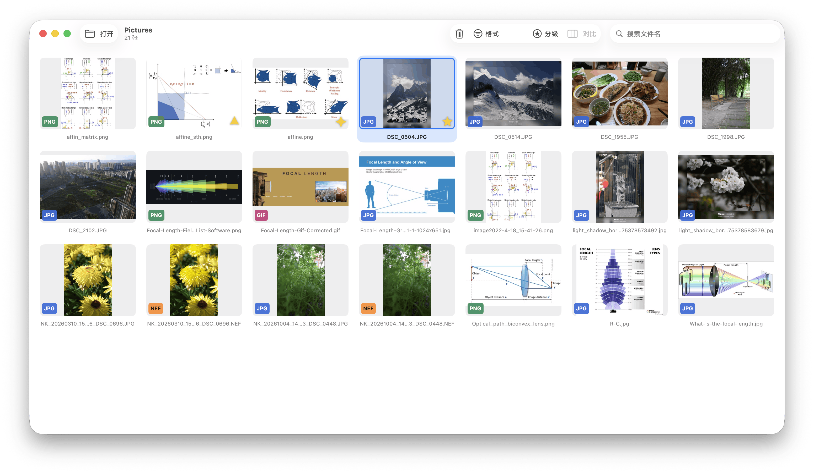
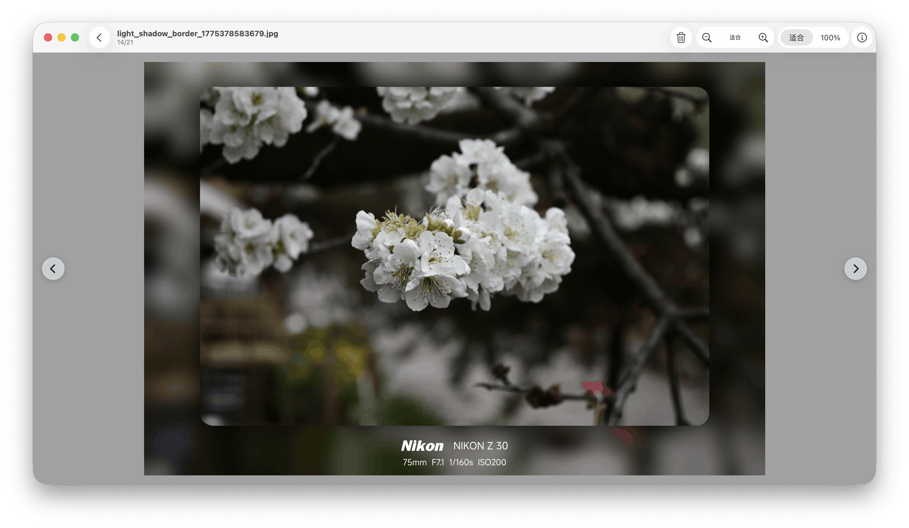
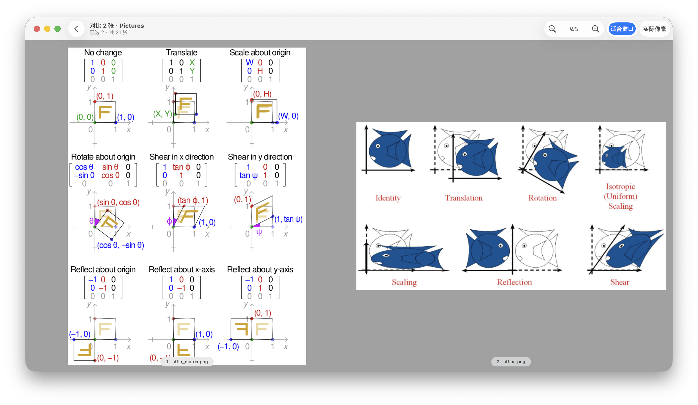

# FastImageView

## 简介

一个专注速度的 macOS 本地看图应用。

受够了系统“预览”的打开速度，尤其是切图速度，连续点击方向键时甚至会跳过几张图的预览，而且居然不支持自动切换到下一行图片！太不人性化了！虽然市面上已经有很多优秀的看图应用了，但是他们都没有踩中我的需求，于是我 vibe 这一款应用，专注于**快速打开图片，兼顾分级与筛选，快捷键友好**。

**看图：** 提供缩略图网格和大图两种模式。网格模式方便快速定位图片，大图模式下按方向键可以无限毫秒级切换图片（注：为了提高 RAW 图打开速度，实际加载的是原片内嵌的 jpeg 图）。

**筛选：** 支持按照格式筛选图片，网格模式下有不同颜色的格式 logo 来快速区分格式。支持按键盘`1`–`5` 对图片进行分级，按 Shift+`1`-`5` 快速筛选分级，支持组合筛选。

**对比：** 支持2–3 张图片同步对比，这不算个大众功能，出于职业习惯添加了这个功能。

应用界面预览：

网格模式：

大图模式：

对比模式：


# 主要功能

### 打开文件夹，立刻开看

- 只浏览当前这一层的图片，不递归子目录；隐藏文件自动跳过，列表按 Finder 的自然顺序排列。
- 自适应缩略图网格，工具栏实时显示图片总数、筛选结果和选中数量。
- 打开或切换文件夹时显示读取进度；文件夹内容变化时列表自动刷新，并提示「列表已更新」。
- 从访达直接双击图片会先进入大图，父目录扫描在后台补全，不必等待整个文件夹读完。
- 支持 `⌘O` 选择目录、拖入文件夹或多张图片，以及「打开最近」快速回到之前的目录。

### 大图查看

- 双击图片在「适合窗口」与「100%」之间切换；`⌘+` / `⌘−`、`⌘` 滚轮或触控板捏合可连续缩放。
- 放大后拖拽平移；图片两侧会出现上一张/下一张按钮，方向键同样可以切换。
- 切换图片时保留上一张作为过渡，减少闪白和等待感。
- GIF 在大图中播放动画，网格里显示首帧。
- iCloud 中仅云端保存的图片会在可见时自动触发下载（最多 4 个并发），界面同步显示「下载中…」或「未下载」。

### 分级与筛选

- 网格和大图都可以按 `1`–`5` 设置分级，再按同一数字取消；大图设置时会弹出黄色徽标反馈。
- 分级按文件路径保存在本机，重启后仍在；重命名或移动文件会丢失该分级。
- `⇧1`–`⇧5` 在网格中切换分级筛选，可与「未分级」、格式筛选和关键字筛选组合使用。
- `⌘F` 搜索文件名，匹配包含扩展名的完整文件名，不区分大小写。
- 格式筛选只列出当前文件夹出现过的格式，支持多选组合；一个都不选等于全部。
- `⌘` 点击或 `⇧` 点击多选；右键菜单提供打开、在访达中显示、拷贝图片/路径/文件名、分级和移到废纸篓。

### 2–3 张同步对比

- 选中 2–3 张图片后按 `P`，或使用右键「对比 N 张」和工具栏「对比」按钮进入。
- 按网格当前显示顺序等宽排列，顺序固定；缩放和平移同步作用于所有格。
- 双击任意格进入该图的大图模式；按 `Esc` 或返回按钮回到对比，并保留原对比集合。
- 对比模式不支持删除，入口在选中超过 3 张时自动禁用并给出提示。

### 拍摄信息与删除撤销

- 大图按 `I` 或点击工具栏「图片信息」，可查看拍摄时间、相机、镜头、光圈、快门、ISO、焦距和像素尺寸；缺失字段自动隐藏。
- `Delete`、`fn+Delete`、`⌘⌫` 或工具栏垃圾桶按钮把选中项移到废纸篓，支持多选批量删除。
- 删除后底部出现可撤销提示，`⌘Z` 也可撤销；撤销仅在本次打开文件夹期间有效。
- 撤销时如果原路径已被占用，不会覆盖现有文件。

## 键盘快捷键

| 操作          | 快捷键                           |
| ----------- | ----------------------------- |
| 打开文件夹       | `⌘O`                          |
| 搜索文件名       | `⌘F`                          |
| 在网格中移动选中    | 方向键（上下按行移动，不循环）               |
| 进入大图        | `Return`、空格或双击                |
| 大图切换图片      | `←` / `→`，或 `↑` / `↓`         |
| 返回网格        | `Esc` 或空格                     |
| 适合窗口 / 100% | 双击图片，或工具栏分段开关                 |
| 放大 / 缩小     | `⌘+` / `⌘−`                   |
| 连续缩放        | `⌘` 滚轮 / 触控板捏合                |
| 放大后平移       | 拖拽                            |
| 多选          | `⌘` 点击 / `⇧` 点击               |
| 设置分级        | `1`–`5`（网格和大图都可用）             |
| 取消分级        | 再按同一数字                        |
| 分级筛选        | `⇧1`–`⇧5`（仅网格）                |
| 对比选中的 2–3 张 | `P`（仅网格）                      |
| 显示 / 隐藏拍摄信息 | `I`（仅大图）                      |
| 拷贝图片        | `⌘C`                          |
| 移到废纸篓       | `Delete` / `fn+Delete` / `⌘⌫` |
| 撤销删除        | `⌘Z`                          |
| 退出对比        | `Esc` 或空格                     |

## 支持的文件

扫描只看扩展名，不区分大小写：

| 类型   | 扩展名                                                              |
| ---- | ---------------------------------------------------------------- |
| 常见图片 | `jpg` `jpeg` `png` `heic` `heif` `gif` `tif` `tiff` `webp` `bmp` |
| 相机原片 | `nef` `cr2` `cr3` `arw` `raf` `orf` `rw2` `dng` `pef`            |

相机原片只读取内嵌的 JPEG 预览，不做传感器全尺寸解码，兼顾速度、内存和缩放时的色彩稳定。隐藏文件、子目录和其他扩展名都会被跳过。

## 系统要求

- macOS 14 或更高版本
- Swift 5.9（随 Xcode 15 或更新的命令行工具提供）

## 从源码运行

在仓库根目录：

```bash
swift build
swift run FastImageView
```

启动后用 `⌘O` 或「打开文件夹」选择目录。

`swift run` 启动的是裸可执行文件，没有 app bundle；程序会在启动时手动切换为前台应用并激活窗口。若需要图标、访达「打开方式」等 bundle 特性，请使用下面的打包脚本。

## 打包为 .app

```bash
Scripts/package-app.sh [目标目录]
```

默认安装到 `/Applications`。脚本会执行 release 构建、组装 `FastImageView.app`、复制图标、ad-hoc 签名，并向 LaunchServices 注册，使访达的「打开方式」可用。目标目录需要可写权限；脚本不做公证，对外分发前请自行完成签名与公证。

## 测试

```bash
swift test
```

没有图形会话时，废纸篓往返测试会自动跳过。未设置 `FASTIMAGEVIEW_NEF_FIXTURE` 时，NEF 预览测试会跳过；这两项跳过不算失败。要跑 NEF 测试，把变量指向一个本地 NEF 文件：

```bash
FASTIMAGEVIEW_NEF_FIXTURE=/path/to/sample.nef swift test
```

若 `swift test` 因 `sandbox-exec` 报 `Operation not permitted`，改用：

```bash
swift test --disable-sandbox
```

测试集中在与 UI 无关的 Core 层，通过协议替身覆盖业务逻辑，不依赖真实文件系统（磁盘缓存类测试除外）。

## 项目结构

```
Sources/
  FastImageViewCore/   # 与 UI 无关的业务逻辑，可单独测试
  FastImageView/       # SwiftUI / AppKit 可执行层
Tests/
  FastImageViewCoreTests/
Scripts/               # 打包脚本与测试 fixture 生成器
Support/Info.plist     # bundle 元数据与图片文档类型声明
Package.swift
```

- `FastImageViewCore` 不 import AppKit 或 SwiftUI，负责目录扫描、预览管线、分级、对比、删除、按键路由等逻辑。
- `FastImageView` 负责窗口、网格、大图、右键菜单、工具栏和事件桥接。
- 关键依赖通过协议注入，并提供测试替身；新增业务逻辑时优先写成可单测的纯函数或可注入服务。

更完整的代码约定与构建说明见 [AGENTS.md](AGENTS.md)。

## 设计取舍

- **不递归子文件夹。** 打开什么就看什么，扫描范围始终只限当前目录，不会因为递归把多层目录里的图片一次读进来。
- **相机原片不做全尺寸解码。** 统一使用内嵌 JPEG 预览，避免内存暴涨；同时避免 ImageIO 针对不同缩放尺寸选择不同处理管线造成颜色跳变。
- **不启用 App Sandbox。** 应用需要直接访问任意本地目录，因此不启用沙盒。
- **缩略图与查看器分车道。** 缩略图与查看器各自限制并发，查看器解码不会被后台缩略图任务阻塞；最近邻图片会预取。
- **缩略图落盘缓存。** 按路径、尺寸和修改时间生成 SHA256 键，命中后直接复用，减少重复解码。
- **过期任务自动丢弃。** 后台扫描和解码都带 generation 校验，快速切换文件夹或缩放时不会把旧结果写回界面。
- **零第三方依赖。** 只使用系统框架，`Package.swift` 不引入任何外部包。

## 已知限制

- 不提供裁剪、旋转、调色或导出功能，也不支持视频。
- 分级按路径保存，移动或重命名文件后会丢失。
- 对比模式固定为当前网格顺序，最多 3 张，且不支持删除。
- 删除直接进废纸篓，不做二次确认。
- 打包脚本只做 ad-hoc 签名，不包含公证流程。

## 参与开发

欢迎提交 Issue 和 Pull Request。修改前建议先运行 `swift test` 确认基线；新增 Core 层逻辑请补充对应单元测试。UI 视觉常量统一放在 `Theme.swift`。
